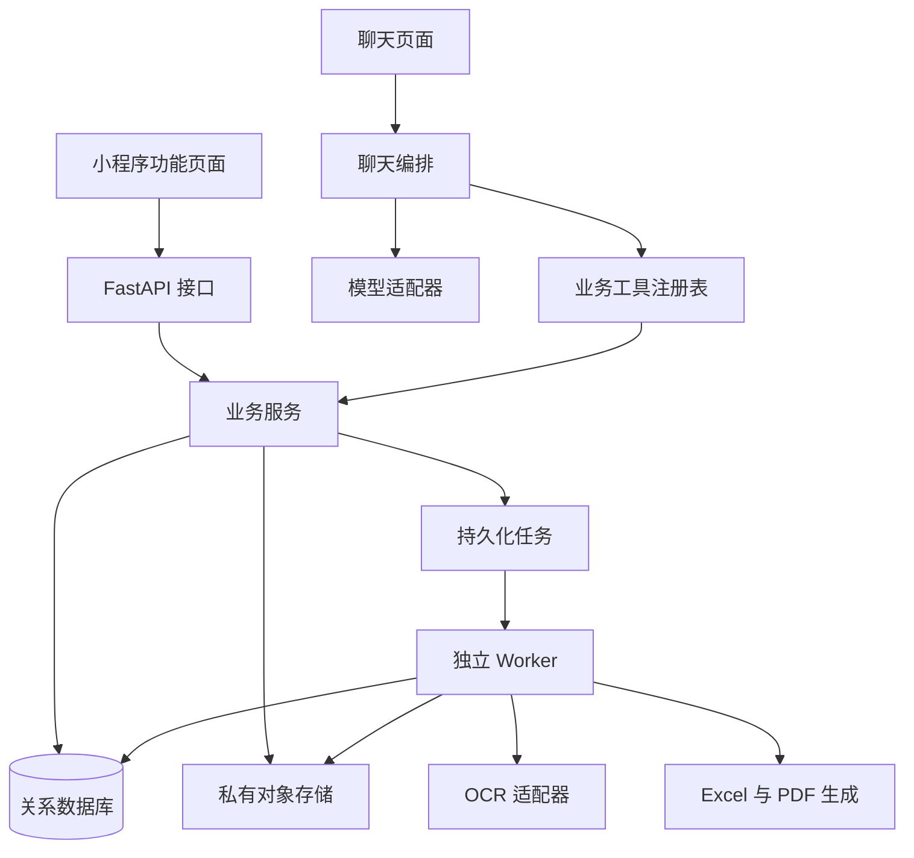

# 金融工具箱后端设计文档

版本：V1.1（实现进度 0.4.0）  
更新日期：2026-10-09  
配套契约：[前后端接口对接文档](api-contract.md)

后端为微信小程序提供票据识别、拆税、导出、记录、用户中心和聊天助手。功能页面和聊天助手使用同一套业务服务、权限及计算规则；耗时处理作为持久化任务执行，用户离开页面后仍可继续。

## 1 需求和实施边界

### 1.1 已明确需求

- Python 3.12 + FastAPI，REST API 使用 `/api/v1`。
- 前端 Vue 3 + TypeScript + uni-app，发布为微信小程序。
- 发票识别、图片/PDF OCR、批次处理、拆税、Excel/PDF 导出、使用记录、用户中心、财税工具扩展。
- 票据类型尽量广泛覆盖，PDF 为基础文件格式。
- 暂不设置产品层面的上传总大小和 PDF 总页数上限。
- 增加通过聊天操作小程序内全部业务的助手。
- 数据库 MySQL 或 PostgreSQL，Redis 可按业务量引入。

### 1.2 建议默认值

以下为可实施的初始方案，尚不代表用户逐项确认。

| 项目 | 初始方案 |
| --- | --- |
| 数据库 | PostgreSQL；已有 MySQL 运维基础可替换，实施时选定一种 |
| OCR | 优先验证覆盖多票种的托管服务，供应商通过适配器隔离 |
| 模型 | 支持结构化工具调用，完成中文业务评测后选择供应商 |
| 拆税 | 含税输入、Decimal、两位小数、ROUND_HALF_UP、税额差额法 |
| 分享 | 用户主动创建、默认 7 天、可撤销；持链接访问对应导出 |
| 导出 | Excel 汇总与明细、PDF 整理报告；与原始文件分开 |
| 上传会话 | 建议 24 小时到期，到期前可续期 |
| 时区 | 数据库 UTC；日期筛选和展示默认 Asia/Shanghai |

原始文件、OCR 原始响应、识别结果、导出、反馈、聊天和审计的保留期限，供应商数据条款，注销删除策略，以及负数/红字拆税范围在对应功能上线前确定。不开启没有实际行为支撑的隐私或通知开关。

### 1.3 首期能力

文件格式先支持 PDF、JPEG、PNG；OFD 等通过转换适配器扩展，验证前标记不可用。票据覆盖目标包括增值税专票/普票、数电发票、机动车票据、火车票、机票行程单、出租车票和通行费票据等，按样本验证发布能力清单。

“可上传”“可识别”“字段已验证”分开记录。未知票据尝试通用字段提取并标记待核对，不伪装完整支持。识别不等于真伪查验。首期不含查验、报税、支付、会员、企业协作。

全部已启用业务可通过聊天工具或关联 UI action 操作；本机文件选取、微信授权、文件打开、系统分享和微信客服仍由前端完成。

## 2 系统架构



采用模块化单体，同一代码仓库分别启动 API 和 Worker。业务服务不依赖 HTTP 请求对象，页面与助手调用相同服务；数据库保存事实状态，对象存储保存文件，不把重要任务状态仅放在进程内。

| 部分 | 选型与职责 |
| --- | --- |
| API/校验 | FastAPI、Pydantic；参数、权限和 OpenAPI |
| 数据访问 | SQLAlchemy、Alembic；会话、事务和迁移 |
| 数据库 | PostgreSQL，金额 NUMERIC，扩展字段 JSONB |
| 文件 | 私有对象存储，分片上传、生命周期和签名地址 |
| Worker | 数据库任务队列起步，规模增长时换 Celery/Redis 等适配器 |
| OCR | 分类、结构化识别、字段标准化和供应商错误适配 |
| 导出 | openpyxl、支持中文字体的 PDF 生成工具 |
| 模型 | 可替换模型适配器、工具调用和用量统计 |
| 运维 | HTTPS、结构化日志、进程管理、健康检查 |

建议目录：

```text
backend/
  app/
    main.py
    api/v1/          # HTTP 适配
    core/            # 配置、身份、错误、日志
    db/              # 模型和事务
    schemas/         # 请求响应模型
    services/        # 业务服务
    integrations/    # 微信、存储、OCR、模型
    agent/           # 会话、执行、工具、事件、确认
    jobs/            # 任务处理、租约、重试
  migrations/
  tests/
  pyproject.toml
```

不提前拆微服务，先独立扩容 Worker；后续按实际瓶颈调整。

## 3 登录和权限

前端获取微信临时 code，后端向微信交换身份，以 `(appid,openid)` 找到或创建用户，再签发本系统登录态。不能信任前端自报 openid。AppSecret、session_key、OCR 和模型密钥仅在服务端使用。

建议短期 access token 加可轮换 refresh token；refresh token 数据库存哈希，刷新后旧值失效。登出撤销当前会话，注销撤销所有会话；期限从配置读取。

文件、批次、票据、计算、导出、对话和任务均按资源 ID 加当前 user_id 查询。助手 user_id 由登录态注入，不由模型参数指定。非本人资源返回 404。分享是单独的公开授权通道，不开放普通业务接口。

工具目录、帮助、小贴士、关于我们可匿名访问。计算、上传、助手及个人记录需要登录。客服沿用微信 `open-type="contact"`。

## 4 文件上传和无产品上限处理

### 4.1 上传流程

1. 创建上传会话，指定名称、预期字节数、类型和用途。
2. 后端返回会话 ID、技术分片尺寸和并发建议。
3. 前端切片，按需取得短期签名上传地址，直传对象存储。
4. 前端提交分片编号和 ETag，后端执行存储合并。
5. 后台验证真实格式、完整性和可读性，文件 ready 后可创建识别批次。
6. 失败可重试，未完成分片及未关联文件到期清理。

ETag 是存储分片标识，不作为通用内容哈希。对象 key 和访问权限由后端生成，完成上传仍需检查文件真实内容，不仅看扩展名。不得接受任意远程 URL 让后端代下载。

### 4.2 不设产品上限的含义

产品不硬编码最多 N MB/N 页。微信客户端、对象存储和 OCR 存在真实能力边界；通过能力接口暴露，遇到边界明确说明，不承诺物理上无限。

- 文件直传，避免 API 常驻内存或等待全部上传。
- PDF 按页或供应商允许的页组拆任务，分段保存进度、合并结果。
- 限制单个进程内存、同时执行数量、单次调用时间，不限制产品总页数。
- PDF 分页、转换和导出在隔离工作进程运行，临时文件可清理。
- 密码保护或损坏文件返回明确错误；首期不收集密码，可上传解密副本。
- 前端支持断点恢复和状态查询，能力字段中的 null 表示无产品上限，不表示没有技术边界。

## 5 识别、核对和重试

### 5.1 资源关系

批次包含文件；文件包含处理单元，通常为一页或一组页；每个单元可识别零张、一张或多张票据。票据保留文件 ID、页码、可选区域坐标、票种、关键字段、明细、原始响应引用、解析版本和核对状态。

未知字段为 null，不能填造假的零。免税、不征税、零税率用独立税收标识，不能全部当作税率 0。供应商能力通过分类、识别、错误归类和标准化接口隔离；电子 PDF 可结合文本结构提取，扫描件走 OCR，两种都执行业务校验。

### 5.2 状态

```text
queued → processing → succeeded / partial_failed / failed
queued / processing → cancelling → cancelled
```

PDF 页数分析完成前 `total_units` 可以未知，`discovery_complete` 表示所有处理单元已发现。进度统计处理单元，票据数量单独统计。未找到票据记录 NO_INVOICE_FOUND，不创建空发票。

partial_failed 表示单元有成功也有失败。succeeded 不代表核对完成，票据另有 pending_review/confirmed。关键字段缺失、低置信度、金额不一致、未知类型都产生核对问题。

### 5.3 重试和修正

- 超时、限流、临时服务错误退避重试；格式错误、文件损坏不自动重试。
- 用户重试只处理失败单元，建立新 attempt；批次可回到 queued。
- 结果按单元和供应商结果标识去重；重试不覆盖人工修正。
- 修正带 expected_version 乐观锁，记录修改前后值、操作者和原因。
- 相同文件按当前用户范围提示重复，不跨用户泄露是否存在。
- OCR 提交后崩溃可能重复计费，优先利用供应商请求幂等/查询能力，否则保留请求 ID 和成本归因。

## 6 拆税计算

建议默认输入含税金额和税率：

```text
net_amount = ROUND_HALF_UP(gross_amount / (1 + tax_rate), 2)
tax_amount = gross_amount - net_amount
```

接口金额和税率用字符串，如 `"113.00"`、`"0.13"`；服务用 Decimal，金额字段建议 NUMERIC(24,2)，税率 NUMERIC(10,6)。禁止 FLOAT。手工拆税首期输入正金额、最多两位小数；票面红字金额可存储，负数拆税需另行明确。超出数字可表示范围返回参数错误。

逐条计算后汇总，保存输入、输出、配置版本和 rule_version。原文档税率作为初始计算选项，不表示各票种都适用，配置应区分票种能力与计算选项。助手不猜测缺失税率。

票面金额/税额优先按识别值保存，拆税创建独立记录，不覆盖票面。关联来源发票时保留 source_invoice_id。

## 7 导出、下载和分享

创建导出固定筛选截止时间、来源 ID、版本和生效字段值，完成快照后交给 Worker。大集合分段写入快照表或存储，避免长事务和巨大 JSON。

来源为票据或拆税记录，支持显式 ID、批次、时间范围。票据默认只导出已确认记录；review_scope=all 可纳入待核对项目，文件必须标注。未匹配数据返回业务错误。

Excel 包含汇总、票据明细及待核对项目；PDF 是汇总报告，与原始发票 PDF 区分。未知值留空、零值保留零。Excel 文本字段做公式注入防护，金额列保持数值。原始单文件下载首期支持，打包 ZIP 后续扩展。

任务状态 queued/processing/succeeded/failed/cancelling/cancelled；文件状态 pending/available/expired/deleted。任务成功后文件过期不改变历史任务成功状态，允许基于保留快照重新导出。

下载校验权限后发短期签名 URL，建议初值 5 分钟。分享主动创建，建议默认 7 天；高熵 token，数据库存哈希，支持撤销，只开放该次导出文件。公开分享页校验 token 和文件后签发下载地址。撤销阻止后续新授权，已发签名 URL 可能在自身有效期内仍可用，界面不承诺立即回收已下载文件。

## 8 记录、内容和用户中心

使用记录从批次、计算、导出统一投影，提供 type/resource_id/title/status/created_at，按时间与 ID 稳定排序。助手创建的记录同样出现在功能页面。

通知初期仅站内任务状态，微信订阅消息先标记 unavailable，完成模板及授权后开放。隐私设置先提供助手会话历史保留开关，默认只影响后续会话，不自动删除旧历史；业务记录和审计按独立策略保留。具体期限上线前确定。

账号支持个人资料、安全信息和登出。注销能力在删除政策确定后启用，异步撤销会话和分享并处理关联数据；未启用时能力字段为 false，提供支持入口。帮助和小贴士用配置/种子数据起步，运营后台按需求增加。

## 9 聊天助手

### 9.1 业务工具

一个助手编排多个确定性工具，不直接访问数据库或执行任意代码。模型提出工具及参数，服务端验证和执行，返回真实资源结果。金额计算和导出由业务代码完成。

| 业务 | 工具集合 |
| --- | --- |
| 工具与内容 | search_tools、get_help、get_invoice_tips、get_app_about |
| 文件 | inspect_uploaded_files、get_file_download；本机选取走 UI action |
| 发票 | create_invoice_batch、get_batch、list_batches、query_invoices、get_invoice、update_invoice、confirm_invoice、retry_batch、cancel_batch |
| 拆税 | get_tax_config、calculate_tax、list_tax_calculations、get_tax_calculation |
| 导出 | create_export、get_export、list_exports、get_export_download、cancel_export |
| 分享 | create_share、revoke_share |
| 记录 | query_records、get_user_tools |
| 用户 | get_profile、update_profile、get_security、get_settings、update_settings、submit_feedback、request_account_deletion |

每个已启用业务有工具或关联 UI action；登出、微信客服、下载打开、系统分享和微信授权由前端执行。未启用功能明确说明，不返回虚假成功。

### 9.2 执行状态与恢复

```text
queued → running → waiting_input / waiting_confirmation / waiting_task
waiting_* → running → succeeded / failed
queued / running / waiting_* → cancelling → cancelled
```

消息创建 run，同会话最多一个活动 run。当前批次、选中票据、导出等保存为结构化上下文；存在多个指代候选时询问用户。

创建长任务后进入 waiting_task，后台结果唤醒后续步骤。执行计划、步骤、工具参数和结果持久化，恢复不重新执行成功副作用。关闭页面不取消任务，不依赖长连接一直存活。

取消 run 默认只停止编排，已提交 OCR/导出继续；取消关联任务须显式指定，前端显示实际取消结果。取消不强制中断供应商已接收的请求。

### 9.3 执行与确认

| 操作 | 策略 |
| --- | --- |
| 查询、明确参数的计算、用户明确要求的识别和导出 | 直接执行并展示范围、状态 |
| 缺少税率、日期不明、指代多个资源 | waiting_input，询问具体参数 |
| 明确字段和新值的单条修正 | 校验版本后执行，展示变更 |
| 模型推测修正、批量改写、开放分享、注销 | 准备具体范围和后果，waiting_confirmation |
| 已展示范围及期限且用户明确授权分享 | 复用授权，不重复确认 |

确认 action 保存服务端准备参数、资源版本、摘要指纹和到期时间，只能消费一次。确认时资源有变则重新准备；客户端不能借确认提交未展示的任意参数。自然语言“确认”仅在唯一待处理 action 时才关联。

### 9.4 事件和卡片

消息发送用短 HTTP 请求，增量事件通过带游标的 HTTP 长轮询，首期不依赖浏览器 EventSource。事件落库、sequence 递增、重复去重、断线续拉。需要逐 token 展示时可增加 WebSocket。

卡片类型为批次、发票、拆税、导出、分享、文件选取和确认/选择。卡片数据取真实业务结果，不从助手文字中解析状态。

附件和 OCR 文本为不可信数据，不能增加权限或改变工具规则。优先向模型提供最小结构化数据，不默认上传全部原始票据。模型采购时确认地区、数据使用和保留条件。

### 9.5 成本和失败控制

配置单次 run 工具步数、模型调用次数、执行时间；内部预算耗尽明确返回失败或待继续状态，不编造完成。记录模型用量、OCR 次数、工具耗时，不在日志存完整票据或密钥。大批次通过分页和汇总工具查询，避免将所有记录放入模型上下文。

## 10 数据模型

ID 对外字符串 UUID/ULID，时间 UTC。通用 created_at/updated_at，用户资源含 user_id，可修改实体含 version。核心金额不能 FLOAT，未知金额可为 NULL。

| 表 | 关键字段或约束 |
| --- | --- |
| users | appid、openid、unionid、display_name、status；唯一 appid+openid |
| auth_sessions | user_id、refresh_token_hash、token_family、expires_at、revoked_at |
| user_settings | user_id 唯一、notification_json、privacy_json、version |
| tools | code 唯一、name、route、enabled、sort_order、capabilities |
| upload_sessions | user_id、purpose、object_key、expected_size、status、expires_at、storage_upload_id |
| upload_parts | session_id、part_number、etag、size；组合唯一 |
| files | user_id、purpose、object_key、mime_type、size、sha256、status、expires_at |
| invoice_batches | user_id、status、统计、discovery_complete、source、version |
| batch_files | batch_id、file_id、position；组合唯一 |
| invoice_units | batch_id、file_id、页范围、unit_key、status、attempt；批次+unit_key 唯一 |
| invoices | user_id、batch_id、unit_id、票种、号码、日期、买卖方、金额、review_status、version、extended_fields |
| invoice_lines | invoice_id、行号、商品、数量、金额、税率、税额、税收标识 |
| ocr_results | unit_id、provider、request_id、raw_object_key、parser_version |
| invoice_revisions | invoice_id、操作者、before、after、version、reason |
| tax_configs | version、effective_at、invoice_type_code、allowed_rates、enabled |
| tax_calculations | user_id、金额、税率、rule_version、config_version、source_invoice_id |
| exports | user_id、format、source_type、criteria、snapshot_ref、status、file_id、error |
| export_sources | export_id、resource_id、resource_version、snapshot_data |
| share_links | user_id、export_id、token_hash 唯一、expires_at、revoked_at |
| jobs | type、resource_id、status、available_at、attempt、lease_owner、lease_until、dedupe_key 唯一 |
| idempotency_keys | user_id、operation、key、request_hash、response_ref、expires_at；组合唯一 |
| content_articles | slug 唯一、category、title、body、version、enabled |
| feedback | user_id、category、content、attachment_refs、status |
| chat_sessions | user_id、title、history_policy、last_sequence、resource_context、status |
| chat_messages | session_id、role、client_message_id、content、file_refs；客户端消息幂等唯一 |
| agent_runs | user_id、session_id、status、plan、step_cursor、deadline、active_action_id |
| tool_calls | run_id、step_key、tool_name、validated_input、result_ref、status、idempotency_key |
| chat_actions | run_id、type、prepared_payload、payload_hash、resource_versions、expires_at、status |
| chat_events | session_id、sequence、run_id、type、payload；会话+sequence 唯一 |
| model_usage | run_id、provider、model、token 计数、latency、cost_estimate |
| account_deletion_requests | user_id、status、requested_at、completed_at、policy_version |

主列表索引 (user_id,created_at,id)，任务领取 (status,available_at)，事件 (session_id,sequence)。核心关系有外键。OCR 原值、标准化值和修正值保留追溯；扩展 JSON 不替代全部核心列。

## 11 任务可靠性和事务

业务资源和 jobs 在同一数据库事务提交。Worker 行锁领取并设置租约，耗时执行在事务外，心跳续租；租约过期可回收，回写检查租约 token，避免旧 Worker 覆盖新结果。

执行为至少一次，不承诺恰好一次。结果、导出、助手工具副作用用稳定 step key、幂等键和唯一约束保护。对象 key 包含版本，完整生成校验后才 available，失败产物清理。

迁移到 Redis 队列时使用事务 outbox，数据库提交与消息投递不能变成互不关联的两步。

## 12 安全、部署和观测

- HTTPS，微信请求/上传/下载域名及对象存储直传真机验证。
- 密钥从部署环境/密钥管理读取，不进入仓库、小程序包或模型提示。
- 脱敏日志关联 request_id 和任务 ID，不记录完整分享 token、税号和票据原文。
- API 与 Worker 独立健康检查，监控积压、最旧任务等待、失败率、处理时长、OCR/模型成本。
- 数据库备份和对象存储恢复一起验证；开发、测试、生产隔离。
- 文件转换隔离、临时目录清理、中文 PDF 字体授权及渲染验证。
- 任务和签名 URL 到期由定时清理任务处理，文件保留策略确定后配置生命周期。

## 13 实施阶段和验收

预计 8 至 12 周，前提是一名熟悉后端的开发者、前端配合、托管 OCR 和模型，不是固定交付承诺。

| 阶段 | 交付 | 验收 |
| --- | --- | --- |
| 1 基础与验证 | 工程、迁移、登录、分片上传、供应商样本 | 真机 PDF 上传、权限隔离、票种覆盖记录 |
| 2 核心业务 | 分页、多票 OCR、批次、修正、重试、拆税 | 混合票据、部分失败、金额边界、重启恢复 |
| 3 导出与记录 | 快照、Excel/PDF、下载、分享、记录 | 文件一致、中文可读、分享到期与撤销 |
| 4 助手基础 | 会话、工具、事件、状态卡片 | 聊天可识别、计算、查询和导出 |
| 5 助手全覆盖 | 连续任务、指代、确认、恢复、用户工具 | 全部已启用业务可由聊天或 UI action 完成 |
| 6 上线 | 真机、恢复、权限、备份、观测 | 实际 OpenAPI 与契约一致，关键用例通过 |

重点用例：113 元/13%、舍入、未知税率、重复请求、越权、损坏/密码 PDF、一页多票、部分失败、重试不覆盖修正、导出快照、分享撤销、助手恢复、确认过期、恶意附件指令、关闭页面后恢复。

## 14 参考和上线前决定

技术参考不表示供应商已选定：

- [FastAPI 后台任务](https://fastapi.tiangolo.com/tutorial/background-tasks/)
- [腾讯云通用票据识别高级版](https://cloud.tencent.com/document/product/866/90802)，供应商的格式、票种和单次页数能力在集成时重新核对。
- [结构化工具调用](https://platform.claude.com/docs/en/agents-and-tools/tool-use/overview)

上线前明确数据库、供应商数据条款、能力清单、文件/聊天保留期限、舍入口径、分享期限、注销政策和微信订阅消息。能力未启用时接口返回 false，前端不显示可执行按钮。


## 14 第二阶段实现记录（0.2.0）

已实现 COS 直传、腾讯票据识别高级版适配、批次和单页处理单元、原始响应、人工修正、确认、失败重试与审计。任务分块发现 PDF 页码；供应商每次处理一页，输入过大时转换该页，产品不新增页数/大小上限。

原始响应通过单元和 generation 关联；票据 original_data 保留首次归一化结果，扩展字段含 normalization_version。重试去重保留人工修正；供应商云端调用不具有本工程可依赖的请求幂等保证，可能重复调用计费。具体实现范围、测试和未完成的生产验证见 [开发进度](development-status.md) 与 [发票对接指南](invoice-integration.md)。

补充币种规则：currency 只读，供应商明确币种原样保存；国内常规默认 CNY，海外未知为 UNKNOWN。没有汇率换算；后续导出汇总先按币种隔离，UNKNOWN 单列待核对，不能将不同币种相加。

第三阶段实施导出快照、Excel/PDF 和主动分享；第四阶段完成聊天会话、持久化执行、事件、澄清确认和模型调用。真实云服务、票种脱敏样本与 PostgreSQL 并发恢复验证可在具备环境后并行推进。


## 15 第三阶段实现记录（0.3.0）

导出采用 Export、ExportSnapshot、ExportFile、ExportShare 独立模型。创建事务选择本人记录并保存固定快照，Worker 生成 Excel/PDF，文件使用每次生成独立对象键，只有有效租约能发布数据库可见结果。取消和旧 Worker 不会把文件变成可下载的成功结果。

快照保存创建时的票面和核对信息，汇总按币种隔离并统计缺失项。Excel 流式写入、保留大金额精确文本并在单表行数边界续表；PDF 提供摘要、表头重复和长文本跨页。大量快照事务和 PDF 内存仍需压测。

分享主动创建，父导出资源加锁，最多一个活动分享。公开凭证存哈希，幂等响应中的凭证认证加密；查询不泄露旧凭证。期限为请求期限与文件期限的较早者，公开查询和新下载授权重检撤销及过期；COS 既有短签名地址不承诺即时回收。

当前导出访问期限默认 7 天，可配置，与原始记录和物理删除政策区分；原件、审计、快照和遗留对象清理仍需上线策略。完整说明见 [导出对接指南](export-integration.md)。下一阶段实现聊天会话、持久化执行、参数澄清、分享确认 action 和事件。


## 16 第四阶段实现记录（0.4.0）

聊天采用 LangGraph Python StateGraph；模型通过 ModelProvider 和可配置 Chat Completions HTTP 适配器隔离。默认 disabled，不绑定供应商；无需部署 LangSmith 平台。图执行显式关闭隐式远程追踪，不上传业务内容到追踪平台。

每个 run 是图 thread；graph 的 model/tools/wait/action 节点每次执行一个有界 tick，由现有持久化 Worker 驱动。模型网络请求先执行，写回时检查租约、run 是否取消和当前 tick；所有确定性工具效果、AgentStep、run 状态、事件及检查点在同一事务提交。TransactionSaver 在内存暂存 LangGraph 回调写入，图完成后由事务所属线程存入 SQLAlchemy 表，避免把 Session 共享给检查点线程。序列化只接受 JSON，不使用 pickle。run.state 为运行投影和 action 恢复入口，检查点保留图执行轨迹；关闭页面、重启 API/Worker 不依赖进程内记忆。

等待/确认由应用的持久化 action 和任务状态管理，首期不使用 LangGraph 原生 interrupt，也不保持一个跨等待期占用 Worker 的图调用。无进展的任务轮询复用同一 Job；input/confirmation 到期有后台检查。多工具回复按顺序执行，暂停后继续原工具列表。

新增 chat_sessions/agent_runs/chat_messages/agent_steps/chat_actions/chat_events/chat_checkpoints 七张表；会话行锁和版本字段保护单一活动 run 与事件序列。迁移 head 为 fc350caf6e68。生产仍选 PostgreSQL，本地 SQLite 仅用于开发验证。

首期 40 个工具覆盖拆税、票据查询与处理、历史/工具/帮助、导出/分享、资料/设置/反馈及前端 UI 请求。用户 ID 和操作键由后端生成；敏感工具在注册器和执行器两处受确认约束。购买方、税号、原始 OCR、扩展字段、访问凭证不发送给模型；确认范围来自业务数据，分享结果 AES-GCM 加密，读取时检查有效性。

当前版本对所有票据/资料/设置修改采取确认，较第 9 节的按明确意图区分策略更保守；后续通过评测及可验证的明确授权信息再细分。确认后到执行前仍复核版本与范围，变化时必须展示替代 action。分享结果的绝对到期时间不超过已确认时间。

关闭历史的新会话临时存储 24 小时；删除会话清除内容、检查点和执行记录，不删除业务资源。模型调用次数、工具次数、context 字符数、总 tokens 和 run/action 期限均可配置；记录用量不提供供应商账单估算。实际接口字段、取消语义和前端流程见 [聊天对接指南](chat-integration.md)。

框架依据：[LangGraph Overview](https://docs.langchain.com/oss/python/langgraph/overview)、[持久化](https://docs.langchain.com/oss/python/langgraph/persistence)。锁定依赖版本为 LangGraph 1.2.14。
